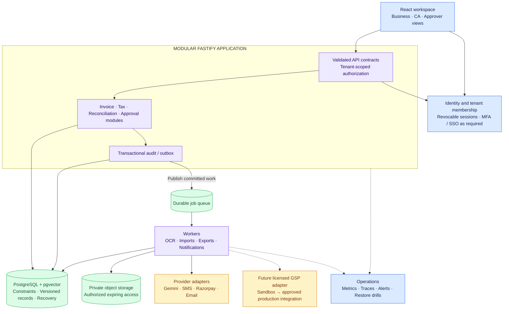

# KhataGST enterprise readiness

Source review: 20 November 2026. This plan is based on the checked-in code, not a penetration test or a certification of the deployed service. Changes below are proposed work.

KhataGST has a useful foundation: separated frontend/backend applications, SQL migrations, invoice transactions, calculation services, reconciliation, and tests. Enterprise readiness now depends on access isolation, trustworthy state transitions, recoverability, and evidence that controls work.

## P0 — before real customer data or live payments

| Gap observed in source | Change to make | Acceptance evidence |
| --- | --- | --- |
| `admin.ts` allows both `admin` and `owner`; migration `003` defaults users to `owner`. Admin queries include platform-wide records. | Separate platform administrators from business owners. Restrict platform endpoints to explicitly provisioned administrators. | A new owner receives 403 on all platform admin endpoints and cannot discover another tenant's records. |
| `aiCaRoutes.ts` authenticates `/audit-invoice` but fetches the invoice by ID without checking business access. | Apply a shared object-level policy before retrieving invoices and line items. Review every endpoint accepting a record ID. | Two-business regression tests deny cross-business audits, reads, writes, scans, reconciliation, and exports. |
| `otp.ts` allows predictable phone-last-four OTPs in production; `render.yaml` selects this mode. Seven-day JWTs are stored in browser local storage. | Reject demo auth in production. Use random SMS OTPs, atomic single-use verification, persistent abuse limits, and revocable sessions. Evaluate short access tokens with rotated refresh sessions in secure HttpOnly cookies and appropriate CSRF protection. | Production refuses demo auth; concurrent verification and replay fail; logout and disabling an account revoke access. |
| `/payments/verify` trusts the submitted plan and grants entitlement without checking that the owned payment update found a row. | Load the owned order first; derive plan and amount from stored data. Verify provider status, order, amount, and currency. Commit payment and entitlement together; fail closed without secrets. | A basic order cannot activate a higher plan. Foreign/unknown orders fail. Concurrent retries grant entitlement once. |
| Webhook verification signs `JSON.stringify(request.body)`, rather than original bytes; deduplication uses a read-then-write status check. | Verify the raw body with the dedicated webhook secret. Persist unique event IDs and process payment, entitlement, and event state atomically. Handle out-of-order events. | Valid raw payloads succeed; altered payloads fail; duplicate/concurrent events do not repeat side effects. |
| `storageService.ts` constructs public-style URLs and falls back to disk after cloud failures. `getUrl()` does not sign downloads. | Use private buckets and authorize short-lived signed downloads. Fail visibly if durable storage fails in production. Validate file contents and scan uploads for malware. | Foreign users cannot retrieve documents; links expire; cloud failures do not silently produce ephemeral files. |
| `db.ts` disables certificate verification and retries writes as well as reads after connection failures. | Verify database TLS certificates; restrict automatic write retries to demonstrably idempotent operations. Validate production configuration at boot. | Invalid certificates fail; a lost response after a committed write cannot create duplicate operations. |

Object-level checks should cover every operation on a user-selected record, as described in [OWASP's authorization guidance](https://api-security.owasp.org/editions/2023/en/0xa1-broken-object-level-authorization/). Razorpay documents [raw-body signature verification and duplicate event handling](https://razorpay.com/docs/webhooks/validate-test/).

## P1 — before enterprise pilots

| Area | Proposed implementation | Release gate |
| --- | --- | --- |
| Tenant permissions | Organizations and business memberships with scoped read/write/approve roles. Centralize linked-CA permissions; consider PostgreSQL row-level security as an additional boundary. | Role matrix tests cover owners, accountants, viewers, approvers, linked CAs, and platform admins. |
| Approval and period controls | Draft → reviewed → approved → prepared states, reviewer identity, versioned snapshots, and period locks with audited reopening. | Required review cannot be bypassed; editing approved records invalidates dependent summaries. |
| Durable background work | Workers for bulk OCR, reconciliation, exports, and notifications. Durable queue such as BullMQ/Redis with bounded retries, deduplication, progress, and failed-job inspection. | Restart loses no accepted job; retries do not duplicate invoices or notifications. |
| Audit evidence | Existing logging is best-effort and rows can be deleted. Use transactional audit/outbox events with actor, tenant, entity, change, request ID, and timestamp; define retention and restricted deletion. | Sensitive state cannot commit without a durable event; retention and account deletion behavior are tested. |
| Transactions and concurrency | Extend invoice transaction patterns to imports, account deletion, payments, and approvals. Add constraints and locking for competing updates. | Mid-operation failure leaves a consistent state; simultaneous updates and repeated imports have defined outcomes. |
| Delivery pipeline | CI for clean installs, backend tests/build, frontend lint/build, dependency checks, secret detection, and migrations against an ephemeral database. Add staging and rollback procedures. | Required checks gate deployment; staging smoke tests cover the preparation workflow. |
| API contracts | Complete request/response schemas, consistent errors, pagination, resource limits, and validated client types. | Contract tests catch incompatible changes and malformed or oversized input. |
| Observability | Extend logs and optional Sentry setup with correlation IDs, PII redaction, latency/error metrics, queue age, and actionable alerts. Separate liveness/readiness; unhealthy readiness returns failure status. | Simulated dependency failures trigger alerts and traffic removal without exposing internals. |
| Recovery | Confirm the actual database restore window; automate independent encrypted backups, document-storage recovery, and restoration drills. Set RPO/RTO from customer needs. | Record an isolated restore, recovered data, and measured elapsed time. |
| Privacy operations | Define retention, export/deletion, and vendor access across records, files, logs, backups, and AI requests. | Demonstrate a test account's data lifecycle with documented retention exceptions. |

## P2 — controlled expansion

1. **Tax-rule governance:** Version rules by effective period, retain authoritative sources, and get domain review of representative cases. Validate exports against the intended portal/tool schema. Integer paise alone does not establish statutory correctness.
2. **AI quality:** Maintain labeled invoice/classification evaluation sets. Measure field accuracy and unsupported answers; verify citations, surface uncertainty, and route ambiguous cases to review. Store model, prompt, and rule versions with decisions.
3. **GSTN connectivity:** Add a licensed GSP adapter and sandbox tests for synchronization and filing. Distinguish local decisions from submitted portal actions. Store consent, submission IDs, acknowledgements, and recovery state before reporting a return as filed.
4. **Enterprise identity:** Add organization invitations, privileged-action MFA, SSO when customers require it, and reliable deprovisioning.
5. **Measured scale:** Load-test representative tenant sizes and filing-period spikes. Tune indexes/pools and add caching or replicas where measured bottlenecks justify them.
6. **Accountant operations:** Build bulk imports with validation reports, a CA client switcher, review queues, and restricted support tooling.

Connected banking and tax payment should be separate future projects with explicit authorization and settlement verification. They are not prerequisites for a reliable return-preparation product.

## Proposed target architecture

This is a future design. Durable workers, Redis, enterprise identity, and live GSP connectivity are not part of the current runtime.

Keep one modular backend initially, with workers deployed separately for long tasks. Establish explicit module interfaces and shared authorization. Split services when independent scaling, deployment, or ownership needs justify it.

## Implementation order

**First:** close admin and invoice access gaps, disable production demo authentication, and correct payment verification. These directly affect data isolation and paid entitlements.

**Next:** secure document retrieval and database connections. Require P0 regression tests in CI, then add scoped memberships and approval snapshots.

**Then:** add durable workers, transactional audit delivery, observability, and measured restoration. Start an enterprise pilot after its acceptance gates pass.

**Finally:** use pilot evidence to prioritize GSP, SSO, imports, and scale. Track completion by demonstrated behavior rather than declaring an entire phase enterprise-ready.
